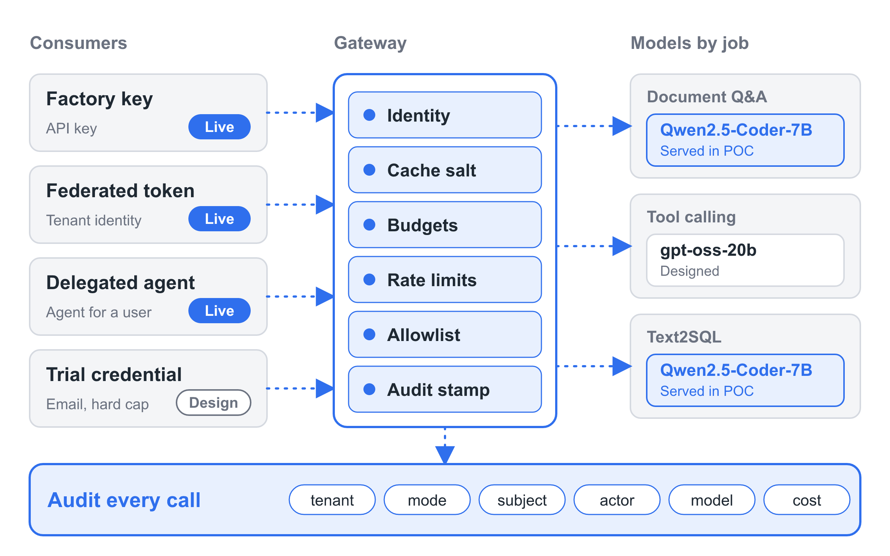
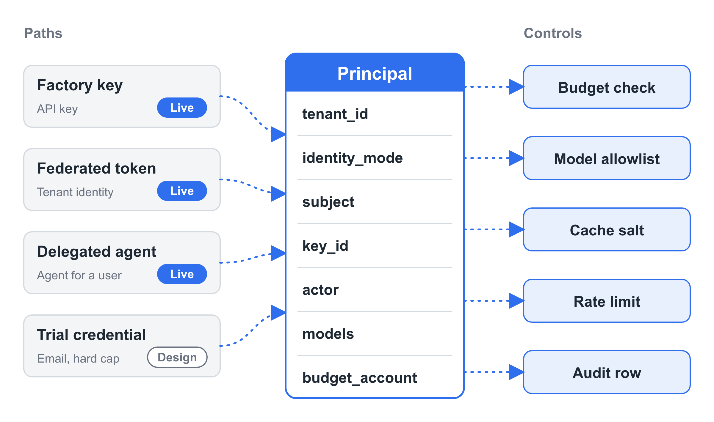
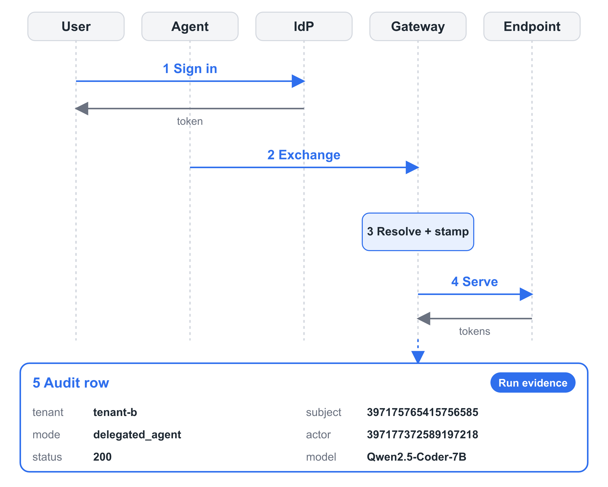

A token factory sells inference as a metered service. Customers send prompts, the factory runs them on shared GPUs, and customers get completions and a bill. This post is a proposal for how to build one, written from the provider's side of the counter.

Five commitments shape the proposal:

- **Lowest cost.** Choose the model and the hardware by cost per outcome, and meter at a price that reflects what the hardware costs.
- **Federate with the customer's identity provider.** Customers sign in with the identity they already run.
- **Isolate each tenant's data and cache.** One tenant's prompts must leave no trace another tenant can measure.
- **Cap each tenant's spend.** The cap refuses the next call once the budget is gone.
- **Audit every call.** Every request leaves a row that says who made it and on whose behalf.

The sections below take them in a different order: isolation, audit, federation, spend cap, cost. Each gives the reason the commitment matters and the mechanism that honours it, then reports what a small working instance showed.

The instance was a proof of concept that I ran once and then shut down. It served Qwen2.5-Coder-7B-Instruct on one rented RTX 4090 behind a gateway, for two tenants and one agent. I describe it in the past tense because the infrastructure no longer exists. The repository holds the configs, the run report and the raw exports.

## Isolate each tenant's data and cache

Shared inference is fast because it reuses work. A prefix cache keeps the attention state for prompt prefixes it has already seen, and a later request with the same prefix skips most of the prefill. A caller can see that reuse as a faster first token.

A preprint (KVGov, arXiv 2608.09225, August 2026, single author, defence evaluated in simulation) measured 149.6 ms for a cold 2,119-token prefix against 32.8 ms when it was cached, on Qwen2.5-7B-Instruct with vLLM on an A100. It also reports that published attacks on this channel reach up to 100% success against unprotected vLLM and SGLang. A second preprint (Chu et al., arXiv 2508.08438) tabulates attacks such as PromptPeek at 99% success and EarlyBird at 89%, and notes that they need only ordinary API access.

The channel also has a CVE. CVE-2025-46570 covers vLLM before version 0.9.0 and carries a LOW rating (CVSS 2.6) because the attack is complex. I cite it for the fact that the signal is measurable and tracked.

AWS's SaaS architecture whitepaper states the rule that applies. An authenticated and authorized user can still reach another tenant's resources unless the service enforces tenant context on every access.

**The mechanism.** vLLM accepts a `cache_salt` on each request. The salt is mixed into the hash of the first cache block, and later blocks chain from that hash, so only requests with the same salt share entries. The factory holds one random secret salt per tenant. The gateway removes any salt the client sends and writes the tenant's own, so a caller cannot pick someone else's. The gateway's own response cache stays off, because a response cache keyed on prompt content would hand one tenant's answer to another.

vLLM's documentation says the salt is not an isolation boundary: tenants still share the scheduler and the GPU. The salt closes the cache-reuse channel. A dedicated instance per tenant is the stronger tier, and I come back to it at the end.

**What the run showed.** The test used one paper from the QASPER dataset as a shared prefix. Each call carried the full paper plus one question, 4,481 prompt tokens, and a pass covered twelve questions. The usage field of each response reports how many prompt tokens came from cache.

After a restart that emptied vLLM's cache, Tenant A ran the twelve calls. Tenant B then ran the same twelve calls on the same paper. Tenant B's first call read 0 of 4,481 prompt tokens from cache. Tenant B's cache did work for Tenant B: on five repeat passes, every first call read 4,480 of 4,481.

Then I restarted vLLM again, switched the gateway's salting off for the control, and ran A and then B. This time Tenant B's first call read 4,480 of 4,481 tokens from Tenant A's cache. The contrast between 0 and 4,480 is the evidence.

Wall-clock times did not separate cold from warm at this prefix length. From my laptop each call took about one second, with a median of 0.969 s for Tenant B and 1.028 s for Tenant A across five repeat passes each, because the network and gateway round trip dominated. The cached-token counts carry the result.

A separate call that carried a salt chosen by the caller still read 2,976 of 2,991 tokens from Tenant A's cache. The gateway had overwritten the salt.

## Audit every call

Logging is turning into a design requirement. Article 12 of the EU AI Act asks high-risk AI systems to allow automatic recording of events over their lifetime, and Article 19 asks providers to keep those logs for at least six months. These obligations do not apply yet. The 2026 Digital Omnibus (Regulation (EU) 2026/1744, in force since 27 July 2026) deferred the high-risk obligations to December 2027 for stand-alone systems and August 2028 for products. I read the text as the direction regulation is taking.

Practice trails the direction. A Cloud Security Alliance survey of 418 IT and security professionals (published April 2026, commissioned by Token Security) found that 82% of enterprises have AI agents running that they do not know about, and 65% had an agent-related incident in the previous 12 months. NIST's AI Risk Management Framework asks for post-deployment monitoring plans and documented incident processes (MANAGE 4.1 and 4.3).

**The mechanism.** The gateway writes one append-only row for every call before it forwards the call. The row holds the time, the tenant, the identity mode, the subject, the actor, the model and a rejected flag. Calls the gateway rejects never reach the model, and they get a row too. Token counts and cost arrive afterward from the metering ledger and join on the response id, so the audit table never recomputes cost. Prompt and response text stays out of both tables.

**What the run showed.** One query over the demo window returned 259 calls, 1,039,846 tokens and $0.206264. It grouped the calls by principal:

- Tenant A's factory key made 163 calls.
- Tenant B's user, signed in through the identity provider, made 84.
- Tenant B's agent, acting for that user, made 10 calls.

Two further rows record delegation requests, which call no model. The agent's rows carry the user as subject and the agent as actor. The joined cost matched the metering ledger's own total for the window to the last digit.

Seventeen ledger rows carry zero spend. Sixteen are budget rejections and one is a rate-limit rejection. The 13 calls the gateway rejected during the identity tests each have a row with a reason: unauthenticated, unregistered_issuer, invalid_token, algorithm_not_allowed, token_expired or wrong_audience.

## Federate with the customer's identity provider

Attackers sign in. CrowdStrike's 2026 Global Threat Report found that 82% of detections were malware-free, with valid-account abuse behind 35% of cloud incidents. Microsoft's 2026 Digital Defense Report, covering July 2025 to June 2026, reports that password spray accounts for over 99% of observed cloud initial-access efforts, in a dataset of 124,146,529 password-spray attacks. Overall password attacks fell 26% year on year, which Microsoft attributes to MFA and passkeys pushing attackers toward other approaches. The share of adversary-in-the-middle phishing and token theft more than doubled in the first half of 2026. The report's chapter title says it briefly: legitimate access becomes the threat.

Verizon's 2026 Data Breach Investigations Report, drawn from more than 22,000 confirmed breaches, puts vulnerability exploitation first among initial access vectors at 31%, with credential abuse at 13%.

Standards point at federation as the answer to who vouches for whom. NIST SP 800-63C-4 (July 2025) describes a credential service provider supplying authentication attributes to separately administered relying parties. The OpenID Foundation finalized the Shared Signals Framework, CAEP and RISC on 16 September 2025, so that a federated session can receive security events after login. For an agent acting for a person, RFC 8693 token exchange issues a token whose subject is the user and whose `act` claim names the agent.

**The mechanism.** A tenant keeps its own identity provider. The gateway checks each token against that issuer's published keys. It accepts asymmetric algorithms only, requires an exact issuer match, requires the expected audience and requires an expiry. It then maps issuer and subject to a tenant from a registry the operator controls. A tenant header from the client counts for nothing.

When an agent acts for a user, the gateway needs both identities. It checks the user's token and the agent's own token, and it requires both to map to the same tenant. Budgets charge the tenant, while rate limits attach to the agent.

**What the run showed.** Tenant B used ZITADEL Cloud's free tier: one organisation, one user, one project and one application. I ran 11 checks against the public gateway, four that should succeed and seven that should be refused.

- Succeeded: a call with the user's token, a delegation request, a call with the delegation token, and a call that carried Tenant A's key plus a header claiming Tenant B. The gateway ignored the header and recorded the call under Tenant A.
- Refused with 401: no token, an unregistered issuer, a token with a tampered payload, an HS256 token under the real issuer's name, a tenant claimed by header alone, an expired token, and a token with the wrong audience.

The identity provider cannot issue an already-expired token, and it always places the project in the audience of its own tokens. For those two cases I registered a temporary test issuer with a throwaway key and removed it afterward.

The agent ran on my laptop and reached the gateway through the public front door, as any customer's agent would. The identity provider instance did not advertise token exchange, so I used the fallback in the design. The gateway checked the user's token and the agent's token, then minted a five-minute token with the user as subject and the agent in an `act` claim. Calls with that token charged Tenant B's budget and ran under the agent's own rate limit.

## Cap each tenant's spend

Consumption pricing fails open. Mandiant's "AI Risk and Resilience in 2026" (Google Cloud, September 2026) describes a reconciliation agent at a financial-services provider that hit a corrupted null value and entered a recursive loop. In under an hour it made over 15,000 reasoning API calls and produced a billing spike of about $50,000.

McKinsey reports that 93% of the respondents to its survey exceed their AI budgets. A Harness survey (2026 State of AI in FinOps, 700 engineering leaders and practitioners, a vendor survey) found that 72% had an unexpected AI bill in the past year. In the same survey 73% had AI cost policies and 13% had basic visibility into AI spend. A policy that cannot refuse the next call records an intention.

**The mechanism.** Each tenant has a budget with a duration, enforced where spend is recorded: per key, and per team when several keys share one account. Spend is written after a call completes, so the cap is near-hard. Calls in flight can overshoot it. The design answers with small `max_tokens` caps, rate limits and one-at-a-time calls in the demo.

**What the run showed.** Tenant A's key received a $0.0143 budget, sized from the measured cost per call so that the stop would land between 40% and 70% of the batch. The runner sent the 33 QASPER questions one at a time through the public gateway. It got 18 answers, a 54.5% stop. The nineteenth call returned HTTP 422 with `budget_exceeded`, and the runner stopped.

The spend rows add up to $0.014329. The last accepted call crossed the cap by $0.000029, about 0.2% of the cap. The overshoot was one call and nothing ran after it.

Tenant B's budget is a team budget shared by a user key and an agent key. A disposable test with a $0.0015 team cap sent two calls from two different keys, which spent $0.0018 together. Both keys were refused after that.

The agent's key has its own limit of 6 requests per minute. A rapid loop of agent calls got 200 for the first six and 429 for the seventh. A user call from the same tenant during the throttling returned 200. The team's spend rose by $0.00204787 over the window, which equals the sum of the completed calls.

## Lowest cost

Inference has become the main workload. Menlo Ventures' mid-year 2025 update (31 July 2025, a survey of 150 technical leaders) reported that 74% of startups and 49% of enterprises say inference accounts for most of their compute. Its December 2025 enterprise report put enterprise AI spend at $37B for 2025. Menlo has published no 2026 edition of either series as of October 2026.

The FinOps Foundation's State of FinOps 2026 (19 February 2026, 1,192 respondents, over $83 billion in annual cloud spend) reports that 98% of respondents now manage AI spend, and that AI cost management is the skill teams most need to develop. McKinsey puts about 60% of an agentic task's cost in refining answers and reports a factor-of-30 variation between completions of the same task. A December 2025 paper by Demirer, Fradkin, Tadelis and Peng found some models served by more than 20 providers, and open-source models 90% cheaper than comparable closed models of the same intelligence.

Cost per outcome settles what a task costs, and the price of a token is one input to it.

**The mechanism.** A rented GPU bills by the hour, so the factory has no per-token cost to pass on. It derives one: the hardware's hourly cost divided by the tokens per hour measured at the concurrency it will run. The same number goes into the metering config as the model's price. Left at zero, every budget reads $0 and no cap can fire.

The choice of model comes from cost per outcome as well. I chose Qwen2.5-Coder-7B-Instruct from earlier measurements, published on 18 October 2026 in an article on a cost-per-outcome framework. It reached 93.3% (14 of 15) on document Q&A at $0.0165 per 1k queries. On Text2SQL (Spider dev, 1,034 questions, execution accuracy) it reached 77.5% at $0.0110 per 1k queries. The highest raw accuracy on that track was an API model at 80.6%, at roughly 6.5 times the cost per query. Those runs used a rented RTX 4090 on Secure Cloud at $0.89 per hour, the same card at the same hourly rate as this run.

**What the run showed.** I measured one client sending the 33-question workload one call at a time: 121,430 tokens in 96.67 seconds, or 4,522,034 tokens per hour. The pod cost $0.897 per hour, made of $0.89 for the GPU and $0.007 for container storage. Dividing gives $1.98e-07 per token, about $0.198 per million tokens, applied to input and output alike. Cached tokens count at the same rate. The price depends on utilization: it allocates the hour across the tokens I measured.

The whole run, including start-up and idle waits, cost about $2.49 across the pod and the droplet. The identity provider's free tier, the domain and the repository cost $0.

## The framework in brief

The design rests on one idea. Every path resolves to the same principal record before anything else happens.

Four paths establish a principal. A factory key is a credential the factory issues. A federated token comes from the tenant's identity provider. A delegated token lets an agent act for a user. A trial credential comes from a verified email under a tiny hard cap. Each path differs in how it proves who is calling, and then the gateway reduces every path to the same record.

*Diagram 1. Three identity paths ran live in the proof of concept: factory key, federated identity provider and delegated agent. The trial tier exists as a design. The catalog groups models by job; the proof of concept served one model, Qwen2.5-Coder-7B-Instruct, marked in blue. Every call ends in an audit row.*

Every downstream control reads the principal and ignores the raw request. The budget check, the model allowlist, the cache salt, the rate limit and the audit row each take their key from the same record.

*Diagram 2. The principal carries a tenant, an identity mode, a subject, a key or client id, an optional actor, the allowed models and a budget account. The controls on the right read those fields.*

The gateway is two pieces. LiteLLM's open-source tier supplies virtual keys, budgets, rate limits and the spend ledger. Its documentation lists JWT and OIDC authentication as an Enterprise feature, so a small service of my own sits in front and handles identity. That service validates tokens, maps them to tenants, overwrites the cache salt, caps request parameters and writes the audit row. It came to about 240 lines of Python.

## One delegated call

The delegated call shows the pieces working together. A user signs in at the tenant's identity provider. The agent presents the user's token and its own credential at the gateway. The gateway resolves the principal and stamps it on the request. The model serves the call. The audit row records both identities.

*Diagram 3. Run evidence from the proof of concept. The exchange step used the gateway's fallback: it validated the user's token and the agent's token, then minted a five-minute token with the user as subject and the agent as actor. The audit row shows tenant-b, mode delegated_agent, the user's subject id, the agent's id as actor and status 200.*

## Scope and limits

Three identity paths ran live: factory key, federated user and delegated agent. The fourth path, the trial tier, exists in the design and has no implementation.

The proof of concept exercised the identity and gateway layers. It has no sandbox layer. No consumer code ran on the factory's infrastructure, so the layer that would isolate tenant-supplied code was out of scope, and this run says nothing about it.

It served one model. Calls were non-streaming, so streaming accounting is out of scope.

The pod was reachable through a public TCP port protected by vLLM's API key, and the droplet's egress rules pinned the pod's address for one container. RunPod offers no IP allowlist. The statement that tenants never reach the pod directly rests on that key and on tenants never holding it.

The cache salt closes one channel. vLLM's own documentation says tenants still share the scheduler and the GPU, and the budget cap is near-hard, so a call in flight can overshoot it.

The workload was small: three papers from the QASPER validation split and 33 questions. QASPER is a dataset from the Allen Institute for AI under a CC BY 4.0 license. Both tenants answered all 33 questions. Mean token F1 on the 29 questions with text answers was 0.456 for Tenant A and 0.457 for Tenant B. Both got 3 of 3 yes/no questions right, and both marked the one unanswerable question as unanswerable. These are the numbers my setup produced, with my own prompt and a 7B coder model on three papers. They do not compare with published leaderboard numbers, which used different prompts and models. They show that the workload ran from end to end through each identity path.

A production service would add billing and invoicing, service-level objectives, multi-region operation, SCIM provisioning, a self-service tenant portal and guardrail tooling.

## What I would build next

Dedicated instances come first. A tier with one serving instance per tenant gives the isolation that a cache salt cannot, and it fits customers who need it.

Next come streaming accounting and the trial tier with hard caps and email verification. After those I would add hash-chained audit rows for tamper evidence, and a run against a tenant's real corporate identity provider with token exchange enabled. For tenants whose agents live in a different trust domain, the IETF draft for identity assertion authorization grants offers an upgrade path from the single-domain exchange used here.

The factory sells inference. The five commitments describe the terms on which it sells.
